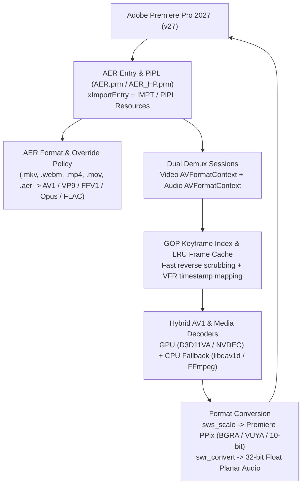

# AER — Clean-Room Importer Plugin Architecture (Premiere Pro 27)

## 1. Project Identity & Isolation
- **Plugin Name**: `AER` (`AER.prm` + optional high-priority `AER_HP.prm`, core library `AERCore.dll`)
- **PiPL Metadata**: Display Name `"AER"`, Match Name `"AER"`, Kind `IMPT`, Force-Import Extension `.aer`
- **Isolated Source Directory**: `d:\AV1\AER\` (completely separate from any existing `Open Media` or other plugin folders)
- **Isolated Premiere Pro 27 Target Directory**:
  - `C:\Program Files\Adobe\Adobe Premiere Pro 2027\PlugIns\Common\AER\`
  - Installing inside Premiere Pro 27's dedicated `PlugIns\Common\AER\` folder ensures **zero interference** with Premiere 2026, After Effects, or any other installed `MediaCore` plugins.

---

## 2. Clean-Room Module Map

---

## 3. Verified Local Build Environment
- **C++ Compiler**: MSVC `14.51.36231` x64 (`Visual Studio 18 BuildTools`) — **Ready**
- **Build System**: `CMake` (`C:\Program Files\CMake\bin\cmake.exe`) + `Git` — **Ready**
- **Target Host**: `Adobe Premiere Pro 2027` (`C:\Program Files\Adobe\Adobe Premiere Pro 2027`) — **Ready**
- **Remaining Inputs Needed Before Compiling `.prm`**:
  1. Official **Adobe Premiere Pro C++ SDK** headers (`Examples/Headers/PrSDKImport.h`, etc.).
  2. **FFmpeg 7.x + `dav1d`** x64 development libraries (via `vcpkg` or prebuilt Windows x64 dev package).
