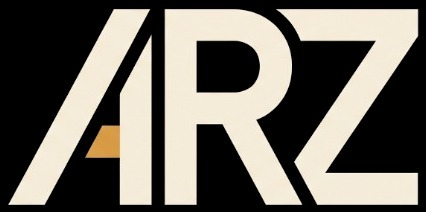

<div align="center">
  
  <h1>ARZ Media Suite v1.0.0</h1>
  <p><b>Native High-Performance AV1 / MKV / WebM / ProRes Importer & RTX NVENC Exporter for Adobe Premiere Pro 2027 & Media Encoder</b></p>
</div>

---

## Overview | نظرة عامة

**ARZ Media Suite (`v1.0.0`)** is a standalone, zero-dependency Windows x64 C++20 MediaCore suite built with **static C++ runtime (`/MT`)** and **FFmpeg 9.1+**, delivering DaVinci Resolve-class timeline scrubbing, two-tier **NVIDIA VRAM $\rightarrow$ System RAM** caching, and native **`Ctrl+M` Hardware/Software Exporting** directly inside **Adobe Premiere Pro 2027**.

حزمة **`ARZ Media Suite v1.0.0`** هي إضافة مستقلة بالكامل لبرنامج **Adobe Premiere Pro 2027** و**Media Encoder** بدون أي متطلبات خارجية على جهاز العميل (`Zero External Dependencies`)، تجمع بين مستورد مزدوج الأولوية لـ **59 صيغة ميديا**، ومصدّر مدمج داخل **`Ctrl+M`** بـ **12 إعداد مسبق (`ARZ Presets`)**، ومركز تحكم ثنائي اللغة (**عربي / إنجليزي**) بهوية وشعار **`ARZ`**.

---

## Key Capabilities | أبرز المميزات

- **59 Media Extensions & 27 Container Families (`ARZ.prm` + `ARZ_HP.prm`)**:
  - `MKV, WebM, MP4, MOV, AVI, MXF, MPEG-TS/M2TS/VOB, WMV/ASF, FLV, IVF/AV1/HEVC, RMVB, GIF, MJPEG, WebP, APNG, JPEG XL, QOI, Bink, GoPro 360, Opus, FLAC, WAV, MP3, AAC, AIFF, DTS/AC3`.
  - Full **Apple ProRes (422 HQ / 4444 + Alpha)**, **ProRes RAW (`prores_raw`)**, **DNxHR**, **GoPro CineForm**, **Resolume DXV**, **FFV1**, and **VP9 + Straight Alpha (`YUVA420P`)**.
- **DaVinci Resolve-Class Timeline Scrubbing (`PrSDKAsyncImporter`)**:
  - Background Latest-Wins async reader with instant stale-request cancellation (`aiCancelAsyncRead`), lazy Matroska `Cues` harvesting, isolated thumbnail decoder, and **`14.2 ms` 4K 10-bit fast-scrub latency** across 2.5-hour movies.
- **100% GPU Color Conversion & Two-Tier `VRAM -> System RAM` Cache**:
  - Hardware `NV12` / `10-bit P010` $\rightarrow$ `BGRA8` via `ID3D11VideoProcessorBlt` on NVIDIA RTX GPUs, caching decoded textures in VRAM up to `82%` before spilling over cleanly into System RAM.
- **Native `Ctrl+M` Exporter (`ARZ_Exporter.prm`)**:
  - **7 `ARZ - ...` Format Profiles**, **12 One-Click `ARZ Presets`**, **15 `[ARZ]` Video Codecs** (`AV1 RTX NVENC`, `SVT-AV1`, `HEVC 10-bit NVENC`, `H.264 NVENC`, `VP9 + Alpha`, `ProRes 4444 + Alpha`, `ProRes 422 HQ`, `DNxHR`, `CineForm`, `FFV1`, `GIF`, `WebP`, `APNG`), and **10 `[ARZ]` Audio Codecs** (`Opus`, `FLAC`, `AAC`, `Vorbis`, `MP3`, `ALAC`, `AC3`, `EAC3`, `PCM 24-bit`, `PCM 32-bit Float`).
- **Bilingual Dark-Mode Control Center (`ARZDesktop.exe`) & Standalone Installer (`ARZ_Setup.exe`)**:
  - Instant **Arabic (`RTL`) $\leftrightarrow$ English (`LTR`)** switch, live GPU/VRAM telemetry viewer, and 1-click Adobe `PluginCache` cleaner.

---

## Quick Client Installation | التثبيت السريع للعميل

1. Close **Adobe Premiere Pro** and **Adobe Media Encoder**.
2. Download and run **`ARZ-PremierePlugin-v1.0.0-Windows-x64-Setup.exe`** from **Releases** (100% self-contained — no VC++ Redistributable, Python, or external FFmpeg installation required!).
3. Launch **Premiere Pro** — import any file onto the timeline or press **`Ctrl+M`** and select any **`ARZ - ...`** format!

---

## Building from Source | البناء من الكود المصدري

1. Place the official **Adobe Premiere Pro C++ SDK** under `third_party/premiere_sdk/Premiere Pro 27.0 C++ SDK` and **FFmpeg Win64 LGPL Shared Dev** under `third_party/ffmpeg/ffmpeg-master-latest-win64-lgpl-shared`.
2. Configure and build with Visual Studio x64 & CMake:
   ```bat
   cmake -B build -G "NMake Makefiles" -DCMAKE_BUILD_TYPE=Release
   cmake --build build
   ```
